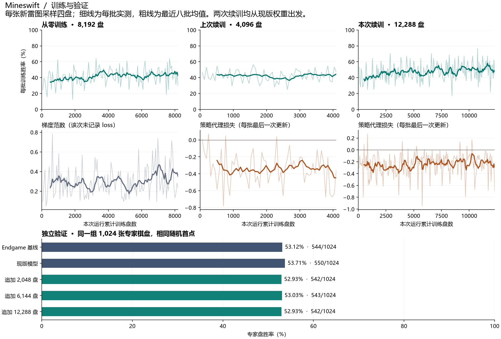

# Mineswift

Mineswift 是一个能接着当前棋盘玩的 Windows 扫雷助手。求解器负责能证明的落子，必须猜时，由从零训练的强化学习模型根据整张可见棋盘选格。你可以在小窗口里看它为什么点这一格，随时按 **Esc** 接回鼠标。

[下载 Windows x64 便携版](https://github.com/MLGBJDLW/Mineswift/releases/latest) · [查看训练曲线](#训练曲线与独立验证胜率) · [复现专家盘评测](#复现专家盘评测) · [反馈问题](https://github.com/MLGBJDLW/Mineswift/issues)

## 使用 Mineswift

在 Releases 页面下载 **Mineswift-Windows-x64.zip**，解压整个压缩包，双击其中的 **Mineswift.exe**。包内自带 Python、模型和运行库。源码运行可使用 Windows x64、Python 3.14，在项目根目录执行以下命令。

```powershell
py -3.14 -m venv .venv
.\.venv\Scripts\python -m pip install -r requirements-web.txt
.\.venv\Scripts\python -m ms.app
```

1. 打开游戏并将棋盘所在标签切到前台，然后点 **识别游戏**。如果只找到一个游戏窗口，程序会直接读盘。如果有多个候选，或游戏标题无法识别，在屏幕上单击要玩的窗口即可。选窗的这次单击不会开格。也可以选 **点选窗口** 或在输入框粘贴网址。新开的网页使用游戏专用 Chrome，交还鼠标或退出助手后，网页仍然可以自己玩。
2. 核对预览中的行列、数字、旗子和剩余雷数。程序可识别逐格网页、经典画布，以及 Windows 窗口截图中的矩形棋盘。截图模式能一起定位已开格和未开格；自定义盘型可输入 `12x18/35`，表示 12 行、18 列、35 雷。在截图模式下总雷数来自盘型设置，请核对游戏设置。
3. 如果自动定位失败，在同一个预览里拖出棋盘边缘，再点一个未开格。特殊皮肤可从下拉框选择数字、旗或雷，再点相应格子作样本。本次绑定期间会记住样本。经典颜色识别适用于蓝 1、绿 2、红 3 等传统配色；其他配色可取消 **经典配色**。
4. 点击 **开始接管**。青色是确定步，橙色是模型猜格，有精确雷率时会显示所选格的含雷概率。点 **交还鼠标** 或按 **Esc** 后可以自己走几步，再按 **开始接管** 接着玩。点 **重开** 或按 **R** 开下一局。网页格子适配器会识别重开按钮，minesweeper.online 的截图适配器也会查找棋盘正上方的笑脸。其他桌面皮肤可在原图中用 **选择重开按钮** 标出位置。

截图接管时，鼠标点完停在该格，下一步直接移到新目标。程序等待连续两帧确认局面。若整个等待期间棋盘始终可读且完全相同，普通左键最多重试一次；无效的双键会切换到逐格开。读盘失败时，**原图 / 读盘** 会放大当时的棋盘，运行日志旁也会保存该帧的棋盘裁图。选择框选棋盘或重开按钮时可以看到整个游戏窗口。对于 minesweeperonline.com 的原生成绩登记弹窗，截图模式会核对其来源和提示文字以确认胜局。按 **R** 或自动续局时，程序会取消登记，然后重开。

经典八邻域使用 `belief_rl.pt` 和小规模残局搜索。**上下左右四邻域** 使用相应的约束求解器，必须猜时调用已在经典规则上训练的整盘模型 `rl_guess.pt`。四邻域未单独训练或测得可发布胜率。六边形、不规则邻接和多雷格需要对应的棋盘表示与求解器。

已在 Chrome 的 minesweeper.online、minesweeperonline.com、minesweeper.cn 和 Simon Tatham 的 Windows 版 Mines 上完成实机对局。网页的首步保护、无猜生成和最后二选一规则会影响实玩胜率。图形程序的运行记录位于 `%LOCALAPPDATA%/Mineswift/runs/`。自动化脚本仍可使用 `python -m ms.play_web --help`。

## 复现专家盘评测

冻结权重 SHA-256 为 `505985d5d667df43bc9cd0a6de5475d9fe6108f600167ee30b1a3560a80adcca`。16×30、99 雷，在 480 格中均匀随机选首点，再在首点及相邻格以外均匀布雷。每个种子固定雷图和首点，模型与 endgame 各玩一次。全程只给模型可见的棋盘，整局胜负计分。几何、网站和桌面测试单独统计。

| 独立种子区间（含两端） | 当前策略 | endgame |
|---|---:|---:|
| [530000–531023](reports/belief_rl_holdout_1024.json) | 540 / 1024 | 521 / 1024 |
| [650000–651023](reports/web_guess_holdout_1024.json) | 532 / 1024 | 516 / 1024 |
| [830000–831023](reports/release_eval_830000.json) | 539 / 1024 | 520 / 1024 |
| 合计 | **1611 / 3072（52.44%）** | **1557 / 3072（50.68%）** |

当前策略的 95% Wilson 区间为 50.67%–54.20%。同盘差值为 +1.76 个百分点，配对 bootstrap 的 95% 区间为 +0.26 至 +3.26 个百分点。前两批成绩在运行第三批前已经公开用于本项目比较，合计是历史汇总。第三批单独的配对检验 p=0.200。

在 Windows 的 CPU 环境、Python 3.14.4 下复现。以下命令从仓库根目录执行，复跑输出写入独立文件。

```console
python -m pip install -r requirements-web.txt -c requirements-eval.txt
python -m experiments.verify_release
python -m experiments.release_eval --games 1024 --seed-base 830000 --jobs 8 --out replay.json
```

`verify_release` 从三个报告逐盘核对模型文件、种子、首点与胜局数。`release_eval` 重新对弈并输出逐盘结果。GitHub Actions 会校验报告、运行测试并抽取四盘实际重放。

在装好项目依赖的 Windows x64 Python 环境中，可以自己生成与发布页相同结构的便携包。压缩包和 SHA-256 校验文件会写入 `release/`。

```powershell
python -m pip install pyinstaller==6.22.3
python -m PyInstaller Mineswift.spec
python packaging/portable_zip.py
```

## 训练曲线与独立验证胜率



从左到右是从零训练、上次续训和本次续训。两次续训都从同一份发布权重出发，横轴各自从零计数。

- **上排看训练时赢了多少。** 每批用 16 张新雷图，每张采样 4 盘。细线是该批 64 盘的胜率，粗线是最近 8 批的平均值。
- **中排看模型怎么学。** 最早那次训练缺少损失记录，所以左图画的是梯度范数，表示这一批给模型的更新信号有多强。中、右两图是每批最后一次更新的策略损失（loss）。每批换一组雷图和猜格轨迹，损失会随样本波动，也可以为负。只凭这条线无法判断模型是否更会赢。
- **下排看续训后有没有变强。** 所有策略用实际部署时的选格方式，挑战同一组未参与训练的专家盘，每盘首点也相同。比较这些横条，就能看到换权重后多赢或少赢了多少盘。

本次从现版追加 **3,072 张新专家雷图，共 12,288 盘**。训练最初和最后各 32 批的胜率分别为 41.50% 和 50.59%。另取 1,024 张相同雷图、相同随机首点作验证，现版赢 550 盘，endgame 赢 544 盘。追加 2,048、6,144、12,288 盘的候选分别赢 542、543、542 盘。最佳候选相对现版少赢 7 盘，差值的配对 95% 区间为 −2.73 至 +1.27 个百分点。继续发布原权重，保留另一组最终测试种子供后续实验。[实验方案、每批指标与逐盘结果](reports/belief_selection_1100000.json)

使用 `python -m pip install matplotlib` 安装绘图依赖后，运行 `python -m experiments.plot_training` 可以重新生成图片。复现实验时给报告另取文件名。

```console
python -m experiments.belief_selection --train-start 1100000 --validation-start 1130000 --test-start 1150000 --checkpoints 512 1536 3072 --validation-games 1024 --validation-endgame --jobs 10 --out replay_training.json
```

在 1,024 张新的随机首点专家盘上，现用模型赢 532 盘，扩大候选搜索赢 536 盘，endgame 赢 516 盘。现用模型的 492 次失败全部来自猜测。在可精确求解的 267 个失败前局面中，11 个落点有更高终局胜率的替代格。113 个致命落点存在可互换的安全格，即使知道两格以外所有安全格的数字也无法区分两种布局。这些统计可以重叠。[残局复盘与逐盘结果](reports/web_guess_holdout_1024.json)

续训使用独立布雷种子，仍然只给终局胜负奖励。先导实验追加 1,024 条轨迹，同盘评测为 248 胜和 251 胜。随后预先固定三段互斥的种子，追加 4,096 条轨迹，仅在 512 张验证盘上筛选三个检查点。同一训练棋盘的四条轨迹始终属于同一组。三个候选分别赢 266、270、272 盘，原权重赢 271 盘，均未通过预设门槛，最终测试集仍封存。优化日志按 epoch 保存代理目标损失、梯度范数、近似 KL 和裁剪比例。[先导实验](reports/belief_continuation_probe.json) · [预设规则与筛选结果](reports/belief_selection_710000.json)

## 初级盘的混合操作

经典 9×9、10 雷的普通模式会记住已经证明的雷。遇到一个线索时，程序计算还需补插几面旗，以及双键能打开几格。补旗再双键比逐格打开至少省一次手势时才插旗，每个手势后都会重新读盘。手动插过的旗需要先由求解器证实。勾选 **盲扫** 可让程序只记雷、逐格打开。

## 程序如何做决定

1. **读盘**。网页适配器读取已显示的格子、表情和计数器，窗口适配器读取像素。两次读盘一致才接管。游戏窗口被遮挡、前台切换、数字矛盾或落子后没有预期变化时，程序停止并显示原因。
2. **证明确定步**。求解器把每个数字变为相邻格的约束，分块枚举边界上的布局，再用剩余雷数把各块及边界外格子合并计数。能证明安全就开格，能证明有雷就标记。程序单独核实用户留下的旗子。
3. **给必须猜的格子排序**。模型输入包括整盘可见状态和剩余雷数。当前经典策略还使用精确雷率和可从盘面计算的信息量。局面足够小时，用同一批相容布局评估候选落点的终局胜负。真实雷图只供模拟器生成局面和赛后诊断使用。
4. **执行**。桌面模式用 Windows 的物理屏幕坐标落子，点击前核对窗口与格子。网页模式核对绑定标签、格子坐标和遮挡。双键无效时回到逐格打开。按 Esc 可以交还鼠标。

| 模块 | 职责 |
|---|---|
| `ms/board.py`、`ms/engine.py` | 可见棋盘的数据格式、自对弈模拟器、首步保护与开空 |
| `ms/solver.py`、`ms/policy.py`、`ms/endgame.py` | 约束传播、全局雷率、候选猜格和有界残局树 |
| `ms/rl.py`、`ms/belief_rl.py`、`ms/belief_search.py` | 从零训练整盘模型，同盘多轨迹训练，模型候选的终局推演 |
| `ms/perception.py`、`ms/desktop_grid.py` | 棋盘定位、字形与图块识别、桌面截图 |
| `ms/web_browser.py`、`ms/web_chrome.py`、`ms/app.py` | 网页格子、画布和统一图形界面 |
| `ms/chording.py`、`ms/executor.py`、`ms/play_web.py` | 双键与记雷规划、鼠标输入、落子前后复核 |
| `ms/eval.py`、`experiments/` | 同盘评测、置信区间、训练和实验入口 |

## 从零训练与历次评测

### 终局奖励与过拟合控制

第一版整盘网络用卷积与全盘池化对各格打分，训练时只在合法格中采样。每次猜测共用本局的终局回报，胜为 +1，负为 −1。完全靠推理获胜的盘计入样本，但不给猜格策略产生梯度。留出评测固定权重，选得分最高的合法格。24 盘链路测试采到 51 次猜测，进行了 3 次参数更新，参数变化的 L2 范数为 0.391。随后用新的随机权重训练 512 盘，共 1,100 次猜测、32 次更新。[链路测试](reports/rl_smoke_24.json) · [训练记录](reports/rl_train_expert_512.json)

独立的 256 张专家盘上，首版模型赢 92 盘，`endgame` 赢 133 盘，单方获胜盘数为 25 对 66。配对差为 −16.02 个百分点，95% 区间为 −23.05 至 −8.98 个百分点。双方均未出现确定步失败或中途停机。[逐盘结果](reports/rl_vs_endgame_expert_256.json)

```console
python -m ms.rl train --games 24 --seed-base 460000 --model-seed 13 --batch 8 --checkpoint models/rl_smoke.pt --out reports/rl_smoke_24.json
python -m ms.rl train --games 512 --seed-base 470000 --model-seed 17 --batch 16 --checkpoint models/rl_guess.pt --out reports/rl_train_expert_512.json
python -m ms.rl compare --checkpoint models/rl_guess.pt --games 256 --seed-base 480000 --jobs 6 --out reports/rl_vs_endgame_expert_256.json
```

第二轮训练为同一雷图和首点采样四条独立动作轨迹，以各轨迹的终局回报减去另外三条的平均回报计算优势，每批做三次裁剪更新。整组全胜或全负也计入训练预算。三个模型各用了 2,048 张雷图、8,192 条轨迹。[训练依据与方案](reports/rl_methods_research.md)

- 原始棋盘模型读取可见格和雷数。带雷率输入的模型还读取各格精确雷率。相容布局不超过 96 种且未开格不超过 48 个时，还可以计算开格后的信息量、辨识布局的机会和预计开空范围。
- 动作价值模型将获胜概率拆为本步存活概率与存活后最终获胜的概率。后一项初值为 0.5，训练标签来自真实轨迹的终局胜负。
- 当前经典策略在相容布局有 3 至 32 种、未开格最多 24 个时，对模型排序最靠前的至多 8 个格子逐一推演到终局，获胜数相同则沿用模型排序。

192 盘开发集上，带终局推演的雷率模型赢 102 盘，直接选格赢 100 盘，`endgame` 赢 105 盘。按开发集结果选定模型后，首批 1,024 张留出盘上分别赢 540、539、521 盘。原始输入对照赢 455 盘，价值模型及其推演版本分别赢 507、513 盘，首版强化学习模型赢 371 盘。后续复验与合计结果见前文。[开发集对照](reports/belief_value_rl_dev_192.json) · [留出集与权重校验值](reports/belief_rl_holdout_1024.json)

```console
python -m experiments.belief_rl train --jobs 8 --checkpoint models/belief_rl.pt --out reports/belief_rl_train_2048.json
python -m experiments.belief_rl train --raw-only --jobs 8 --checkpoint models/raw_group_rl.pt --out reports/raw_group_rl_train_2048.json
python -m experiments.belief_rl train --value --lr 0.002 --jobs 10 --checkpoint models/value_rl.pt --out reports/value_rl_train_2048.json
python -m experiments.belief_rl compare --jobs 12 --games 1024 --seed-base 530000 --checkpoint models/belief_rl.pt --raw-checkpoint models/raw_group_rl.pt --value-checkpoint models/value_rl.pt --rollout --out reports/belief_rl_holdout_1024.json
python -m experiments.belief_audit --out reports/belief_rl_dev_first_guess_512.json
```

上述历史命令会写入指定的模型路径。重做训练时可给 `--checkpoint` 和 `--out` 另取文件名，以保留本机的发布权重。

### 首点和精确概率基线

`ms.eval` 默认在全盘均匀随机选首点。`interior` 只选内部，`edge` 只选边缘，`near-corner` 和 `near-corner-3` 从四个对称近角位置选取，`center` 固定居中。首点改变会改变允许布雷的位置。比较首点规则时共享种子；比较策略时同时固定种子、首点和雷图。

每种首点规则 1,200 局，`endgame` 的结果分别为随机 52.00%、内部 54.00%、近角 52.42%、边缘 53.75%、居中 54.92%。新一批 2,000 局中，随机赢 1,061 局，`near-corner-3` 赢 1,069 局。这些试验尚不足以确定更好的固定开局。[首点评测](reports/expert_opening_sweep_1200.json) · [独立复验](reports/expert_opening_replication_2000.json)

```console
python -m ms.eval --preset expert --policy endgame --opening random
python -m ms.eval --preset expert --games 1200 --seed-base 400000 --jobs 12 --policy endgame --compare-openings random,near-corner,interior,center,edge
python -m ms.eval --preset expert --games 2000 --seed-base 410000 --jobs 12 --policy endgame --compare-openings random,near-corner-3
```

固定居中首点的历史基线中，`exact` 在 2,000 局专家盘胜率为 50.75%（95% 区间 48.6% 至 52.9%），985 局输在猜测。1,000 局复验为 51.1%，两批均未记录确定步失败。另一次 400 局同盘比较中，`exact` 赢 209 盘，局部启发式 `min_prob` 为 0 胜。256 盘需要猜测；590 个猜测局面中，最安全候选的含雷概率中位数为 16.6%，范围为 0.3% 至 50%。单步雷率不能直接换算成整局胜率。[基线报告](reports/expert_2000.json) · [复验](reports/expert_1000_final.json)

### 前瞻和残局树

| 实验 | 同盘结果 | 解释 |
|---|---|---|
| [一步前瞻，1,000 盘](reports/lookahead_vs_exact_expert_1000.json) | `exact` 505 胜，`lookahead` 509 胜 | 最低雷率并列时比较下一步能否证出安全格。差值 +0.4 个百分点，95% 区间 −1.2 至 +2.0 |
| [有界精确残局，首批](reports/endgame_vs_exact_expert_1000.json)及[复验](reports/endgame_vs_exact_expert_replication_1000.json) | 两批各 1,000 盘，`exact` 合计 50.60%，`endgame` 合计 52.55% | 在至多 160 种布局和 48 个未开格时，按点击后能观察到的数字与开空范围分支，合计差值 +1.95 个百分点 |
| [两步存活，1,000 盘](reports/midgame_vs_endgame_expert_1000.json) | 基线 49.70%，`midgame` 50.10% | 评估至多 8 个雷率相近的候选，区间包含零 |
| [扩大搜索树，1,400 盘](reports/deep_endgame_vs_endgame_expert_1400.json) | 基线 52.50%，`deep_endgame` 52.57% | 搜索上限提高到 1,000 种布局和 64 个格子，收益尚不明确 |
| [随机首点推演试验](reports/expert_random_rollout_192.json)及[512 盘复验](reports/expert_random_rollout_holdout_512.json) | 试验双方均 103/192；复验为 275 对 276 | 三个候选共享至多 12 个假想布局 |
| [不可区分的二选一，1,000 盘](reports/expert_random_deadguess_1000.json) | 基线 518 胜，`deadguess` 516 胜 | 能证明两格互换不会改变外围线索时优先猜，未改善总体成绩 |

另有 1,000 局残局复盘，`endgame` 为 541 胜、459 负。失败中 255 次落在已经求出最优动作的有界残局，196 次超出树的范围，7 次在范围内未完成求解，1 次使用了采样概率。赛后在 123 个失败局面找到不可区分的雷格与安全格互换。这描述的是当时的局面，不能推断本局所有早期走法都会失败。[失败复盘](reports/endgame_loss_audit_1000.json)

```console
python -m ms.eval --preset expert --games 1000 --seed-base 100000 --jobs 12 --opening center --compare exact,lookahead
```

```console
python -m ms.eval --preset expert --games 1000 --seed-base 200000 --jobs 12 --opening center --compare exact,endgame
python -m ms.eval --preset expert --games 1000 --seed-base 201000 --jobs 12 --opening center --compare exact,endgame
```

```console
python -m ms.eval --preset expert --games 1000 --seed-base 300000 --jobs 12 --opening center --compare endgame,midgame
python -m ms.eval --preset expert --games 1400 --seed-base 310000 --jobs 12 --opening center --compare endgame,deep_endgame
python -m experiments.loss_audit --games 1000 --seed-base 320000 --jobs 12 --out reports/loss_audit_replay.json
```

```console
python -m ms.eval --preset expert --opening random --games 512 --seed-base 440000 --jobs 12 --compare endgame,rollout
python -m ms.eval --preset expert --opening random --games 1000 --seed-base 450000 --jobs 12 --compare endgame,deadguess
```

本轮参考 David Hill 对小残局进行完整分支分析的做法，仍由冻结模型提出候选，在至多 48 种布局、28 个未开格时，用有界精确搜索评价候选的终局胜数。512 张新的随机首点专家盘上，当前策略赢 **266** 盘，实验策略赢 **267** 盘。只有五张盘胜负不同，实验策略独赢 3 盘、当前策略独赢 2 盘，差值的 95% 配对区间为 −0.59 至 +0.98 个百分点。发布版继续使用当前猜格策略。[逐盘报告](reports/actor_tree_925000.json) · [作者的搜索方法](https://github.com/DavidNHill/JSMinesweeper#brute-force-analysis)

```console
python -m experiments.actor_endgame_probe --games 512 --seed-base 925000 --jobs 6 --out tree-replay.json
```

### 早期监督学习对照

历史实验曾用 13×13 的局部窗口预测雷率。3,000 盘产生 8,118 个真实猜测局面，网络有 18,945 个参数，验证集平均绝对误差为 0.058，准确率为 89.5%。400 局实战中，`learned` 只重排猜格，胜率为 41.0%，同盘 `exact` 为 52.3%。这套数据和模型用于历史对照，现用强化学习权重从随机初始化开始，只按终局胜负优化。[同盘报告](reports/learned_vs_exact_400.json)

## 视觉与执行验证

视觉测试使用独立绘制的字形、斜边、分隔线和抗锯齿棋盘。四种主题合计 1,920 个未开格全部认对，252 个已开测试格中有 251 个通过置信门槛，通过者全部正确。纯色、噪声、错误行数、无格线与低对比度图共五类均被拒绝。早期探针测得 480 格读盘约 20.4 毫秒，耗时会随机器和皮肤而变。[识别探针](reports/perception_probe.txt) · [视觉测试](tests/test_perception.py)

紧贴边缘的像素格线在测试中最大误差为 0.32 像素，抗锯齿格线为 0.04 至 0.97 像素。识别时从每边向内收约 14% 再取字形。格线需填满选区，否则可能整整错开一格。`minesweeper.online` 的回归样本来自一盘实际的半开棋局，在三档缩放下核对全部 81 格。[实盘读盘回归](tests/test_online_capture.py)

执行器支持开格、标旗、中键和左右键组合，并检查落子后目标格是否发生了允许的变化。零格会连锁展开，因此一次点击可以多开格子。[双键测试](tests/test_chording.py) · [输入验证](tests/test_executor.py)

```console
python -m pytest -q
python -m experiments.perception_probe
python -m experiments.executor_probe
```

## 反馈与授权

提交识别或点击问题时，请写明程序版本、游戏网址或桌面版本、盘型、系统显示缩放，以及从哪一步开始出现异常。有需要时可以附上棋盘裁图和相关日志片段。[提交问题](https://github.com/MLGBJDLW/Mineswift/issues)

项目自有代码采用 MIT 许可证。Windows 便携包中的 Python、PyTorch、OpenCV 等依赖保留各自的许可声明，随包可在 `_internal/licences/` 和相应组件目录中查阅。[MIT 许可证](LICENSE)
